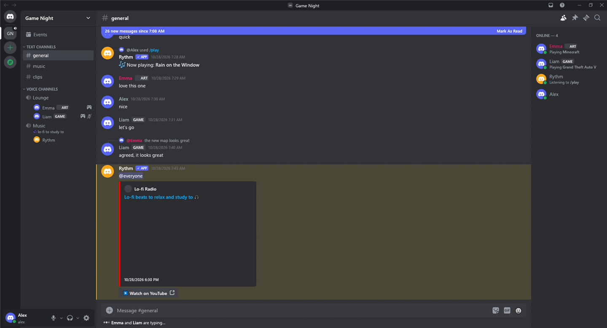
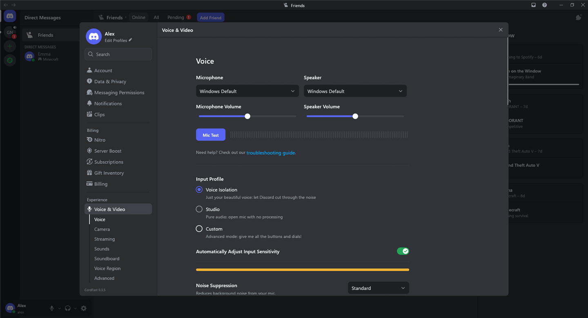

<p align="center">
  
</p>

<h1 align="center">CordFast</h1>

<p align="center">
  <strong>English</strong> · <a href="docs/README.pt-BR.md">Português (Brasil)</a>
</p>

<p align="center"><strong>Discord, native and fast.</strong><br>The whole of Discord in a light native app for Windows and Linux.</p>

<p align="center">
  <a href="https://github.com/ShuShuzinhuu/cordfast/releases/latest"><strong>Download</strong></a> ·
  <a href="#install">Install</a> ·
  <a href="#build">Build</a> ·
  <a href="#features">Features</a>
</p>

<p align="center">
  <a href="Cargo.toml"></a>
  <a href="https://github.com/ShuShuzinhuu/cordfast/releases/latest"></a>
  <a href="#languages"></a>
  <a href="LICENSE"></a>
</p>

CordFast is a Discord client written in Rust with
[egui](https://www.egui.rs) and [fastframe](https://github.com/crmne/fastframe),
the foundation of [ZapFast](https://github.com/crmne/zapfast) and
[Spotifast](https://github.com/crmne/spotifast). It has no browser engine:
it looks and behaves like the official app, with Discord's own icons, menus,
colours and sounds, in about 100 MB of RAM and next to no CPU while idle.

<p align="center">
  
</p>

<p align="center">
  
</p>

[Features](#features) · [Install](#install) · [Build](#build) · [Languages](#languages)

## Features

| Feature | What you can do |
|---|---|
| **Accounts** | Sign in with a password (with 2FA), a QR code from the phone app, or a token, and switch between several accounts. |
| **Servers and DMs** | Folders, categories, threads, forums, announcement and stage channels, direct messages, groups, and the friends page with Active Now. |
| **Messages** | Discord's markdown, mentions, custom emoji, spoilers, embeds, polls, components V2, replies, edits, forwards, reactions and slash commands. |
| **Expressions** | Discord's expression picker: GIFs, stickers and emoji in one popout, with Favorites and Frequently Used from your account. |
| **Voice** | Voice channels and calls with end-to-end encryption (DAVE), AI noise suppression, echo cancellation, push-to-talk on any key and global mute and deafen. |
| **Presence** | Status with a duration, custom status, and games detected by process or reported over Discord's rich presence pipe. |
| **Settings** | Discord's redesigned settings: privacy, messages, notifications and activity saved to your account, plus server settings with roles, permissions and the audit log. |
| **Desktop** | Tray, notifications, start at login, signed automatic updates and every Discord keyboard shortcut, each rebindable. |
| **Themes** | Discord dark and light, AMOLED, Dracula, Gruvbox, Catppuccin, Nord, Rosé Pine, Tokyo Night, or your own colours. |
| **Plugins** | In the spirit of Vencord: NoTrack, MessageLogger, SilentTyping, ClearURLs, ShowHiddenChannels and more. |
| **Game overlay** | Discord's new overlay: voice, quick actions, notifications, text chat and friends over the game, in a window of its own (nothing is injected into the game). |

### Camera and Go Live

Camera and screen sharing (Go Live) are not here. Discord has them turned off
in the country where CordFast is developed, so they cannot be built and tried
against the real service here, and testing them through a VPN would not be a
fair test. **Contributions are very welcome**: if you can use them where you
live, see [CONTRIBUTING.md](CONTRIBUTING.md).

> [!WARNING]
> CordFast is an unofficial client and is not affiliated with Discord.
> Third-party clients break Discord's terms of service and could get an
> account suspended. Use it at your own risk.

## Install

| Platform | Installation |
|---|---|
| **Windows** | Download `…-setup.exe` from [Releases](https://github.com/ShuShuzinhuu/cordfast/releases/latest). It installs without an administrator prompt. A portable `.zip` is there too. |
| **Linux** | Download the `.tar.gz` from [Releases](https://github.com/ShuShuzinhuu/cordfast/releases/latest). Running it needs `libxkbcommon-x11-0`. |
| **From source** | See [Build](#build). |

Copies installed from Releases update themselves when a newer signed version
is published.

## Build

**Windows:** Rust 1.98 and the Visual Studio Build Tools (C++ and CMake).

```sh
cargo build --release
target/release/cordfast.exe
```

**Linux:** the libraries in `scripts/linux.Dockerfile` (on Debian or Ubuntu,
`libopus-dev libasound2-dev libxkbcommon-dev libwayland-dev libx11-dev
libxcursor-dev libxrandr-dev libxi-dev libgl1-mesa-dev libfontconfig1-dev
libfreetype6-dev libdbus-1-dev pkg-config cmake clang`).

```sh
CMAKE=cmake cargo build --release
```

To look at the interface without an account, open the demo session, and go
straight to a screen for screenshots:

```sh
CORDFAST_DEMO=tests/fixtures/demo.json CORDFAST_PREVIEW=guild:0 cargo run
```

`CORDFAST_PREVIEW` also takes `emoji`, `gifs`, `stickers`, `appearance`,
`plugins`, `call`, `member:0`, `server:roles` and more.

**Releases:** with the new version in `Cargo.toml`, a `v<version>` tag (or
"Run workflow" in Actions → Release) builds and publishes the installer, the
portable zip and the Linux package. Updates are signed with the
`CORDFAST_SIGNING_KEY` secret.

## Languages

The interface is available in English, Brazilian Portuguese, Spanish,
French, German, Italian, Russian and Japanese, using Discord's own
translations wherever the text is Discord's. It follows the system's
language until you pick one in Settings → Language & Time.

## Contributing

Pull requests are welcome. Read [CONTRIBUTING.md](CONTRIBUTING.md) first: it
explains how CordFast stays faithful to Discord and light.

## Acknowledgements

CordFast uses [egui](https://www.egui.rs),
[fastframe](https://github.com/crmne/fastframe),
[songbird](https://github.com/serenity-rs/songbird) for voice,
[DeepFilterNet](https://github.com/Rikorose/DeepFilterNet) for noise
suppression, and the ideas of [Vesktop](https://github.com/Vencord/Vesktop),
[Vencord](https://github.com/Vendicated/Vencord) and
[arRPC](https://github.com/OpenAsar/arrpc). Discord is a trademark of
Discord Inc.

Licensed under the [MIT License](LICENSE).
