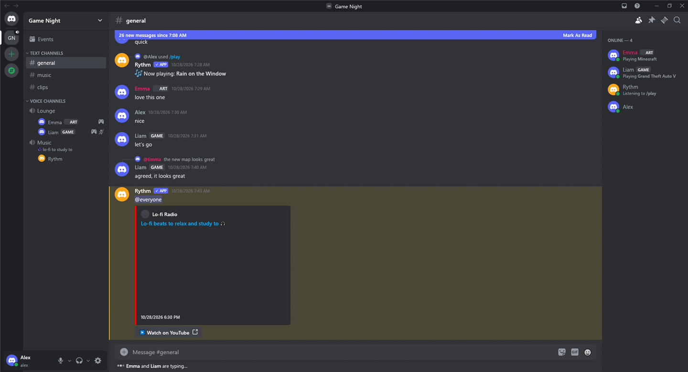
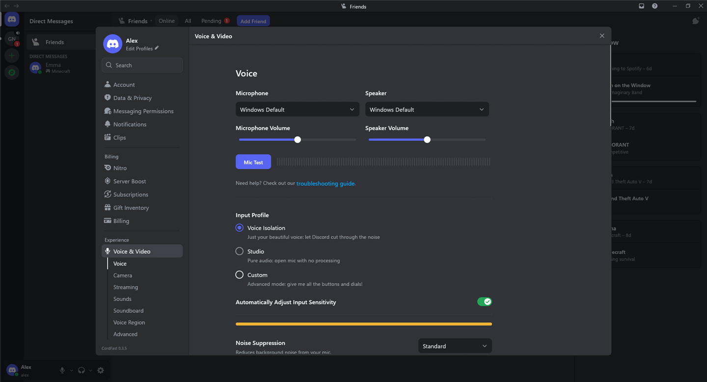

<p align="center">
  
</p>

<h1 align="center">CordFast</h1>

<p align="center">
  <a href="../README.md">English</a> · <strong>Português (Brasil)</strong>
</p>

<p align="center"><strong>Discord, nativo e rápido.</strong><br>O Discord inteiro num app nativo e leve para Windows e Linux.</p>

<p align="center">
  <a href="https://github.com/ShuShuzinhuu/cordfast/releases/latest"><strong>Baixar</strong></a> ·
  <a href="#instalar">Instalar</a> ·
  <a href="#compilar">Compilar</a> ·
  <a href="#o-que-tem">O que tem</a>
</p>

<p align="center">
  <a href="../Cargo.toml"></a>
  <a href="https://github.com/ShuShuzinhuu/cordfast/releases/latest"></a>
  <a href="#idiomas"></a>
  <a href="../LICENSE"></a>
</p>

O CordFast é um cliente do Discord escrito em Rust com
[egui](https://www.egui.rs) e [fastframe](https://github.com/crmne/fastframe),
a base do [ZapFast](https://github.com/crmne/zapfast) e do
[Spotifast](https://github.com/crmne/spotifast). Não tem navegador embutido:
tem a cara e o comportamento do app oficial, com os ícones, menus, cores e
sons do próprio Discord, em cerca de 100 MB de RAM e com CPU perto de zero em
repouso.

<p align="center">
  
</p>

<p align="center">
  
</p>

[O que tem](#o-que-tem) · [Instalar](#instalar) · [Compilar](#compilar) · [Idiomas](#idiomas)

## O que tem

| Recurso | O que dá para fazer |
|---|---|
| **Contas** | Entrar com senha (com 2FA), QR code do app do celular ou token, e alternar entre várias contas. |
| **Servidores e DMs** | Pastas, categorias, threads, fóruns, canais de anúncios e de palco, mensagens diretas, grupos e a página de amigos com o "Ativo agora". |
| **Mensagens** | O markdown do Discord, menções, emojis personalizados, spoilers, embeds, enquetes, components V2, respostas, edições, encaminhamentos, reações e comandos de barra. |
| **Expressões** | O seletor de expressões do Discord: GIFs, figurinhas e emojis num popout só, com Favoritos e Usados com frequência da sua conta. |
| **Voz** | Canais de voz e chamadas com criptografia de ponta a ponta (DAVE), supressão de ruído por IA, cancelamento de eco, push-to-talk em qualquer tecla e silenciar/ensurdecer globais. |
| **Presença** | Status com duração, status personalizado e jogos detectados pelo processo ou informados pelo pipe de rich presence do Discord. |
| **Configurações** | As configurações redesenhadas do Discord: privacidade, mensagens, notificações e atividade salvas na sua conta, além das configurações do servidor com cargos, permissões e registro de auditoria. |
| **Desktop** | Bandeja, notificações, iniciar com o sistema, atualizações automáticas assinadas e todos os atalhos do Discord, cada um reconfigurável. |
| **Temas** | Discord escuro e claro, AMOLED, Dracula, Gruvbox, Catppuccin, Nord, Rosé Pine, Tokyo Night ou as suas próprias cores. |
| **Plugins** | No espírito do Vencord: NoTrack, MessageLogger, SilentTyping, ClearURLs, ShowHiddenChannels e outros. |
| **Sobreposição de jogo** | A nova sobreposição do Discord: voz, ações rápidas, notificações, chat de texto e amigos por cima do jogo, numa janela própria (nada é injetado no jogo). |

### Câmera e Go Live

Câmera e compartilhamento de tela (Go Live) não estão aqui. O Discord deixa
esses recursos desativados no país onde o CordFast é desenvolvido, então não
dá para construí-los e testá-los no serviço de verdade, e testar por VPN não
seria um teste confiável. **Contribuições são muito bem-vindas**: se você
consegue usá-los onde mora, veja o [CONTRIBUTING.md](../CONTRIBUTING.md).

> [!WARNING]
> O CordFast é um cliente não oficial, sem ligação com o Discord. Clientes
> de terceiros violam os termos de serviço do Discord e podem fazer uma conta
> ser suspensa. Use por sua conta e risco.

## Instalar

| Plataforma | Instalação |
|---|---|
| **Windows** | Baixe o `…-setup.exe` em [Releases](https://github.com/ShuShuzinhuu/cordfast/releases/latest). Ele instala sem pedir administrador. Há também um `.zip` portátil. |
| **Linux** | Baixe o `.tar.gz` em [Releases](https://github.com/ShuShuzinhuu/cordfast/releases/latest). Para rodar, precisa de `libxkbcommon-x11-0`. |
| **Do código-fonte** | Veja [Compilar](#compilar). |

As cópias instaladas pelas Releases se atualizam sozinhas quando sai uma
versão nova assinada.

## Compilar

**Windows:** Rust 1.98 e as Visual Studio Build Tools (C++ e CMake).

```sh
cargo build --release
target/release/cordfast.exe
```

**Linux:** as bibliotecas de `scripts/linux.Dockerfile` (no Debian ou Ubuntu,
`libopus-dev libasound2-dev libxkbcommon-dev libwayland-dev libx11-dev
libxcursor-dev libxrandr-dev libxi-dev libgl1-mesa-dev libfontconfig1-dev
libfreetype6-dev libdbus-1-dev pkg-config cmake clang`).

```sh
CMAKE=cmake cargo build --release
```

Para ver a interface sem uma conta, abra a sessão de demonstração e vá direto
a uma tela para tirar screenshots:

```sh
CORDFAST_DEMO=tests/fixtures/demo.json CORDFAST_PREVIEW=guild:0 cargo run
```

O `CORDFAST_PREVIEW` também aceita `emoji`, `gifs`, `stickers`, `appearance`,
`plugins`, `call`, `member:0`, `server:roles` e outros.

**Releases:** com a versão nova no `Cargo.toml`, uma tag `v<versão>` (ou
"Run workflow" em Actions → Release) compila e publica o instalador, o zip
portátil e o pacote de Linux. As atualizações são assinadas com o segredo
`CORDFAST_SIGNING_KEY`.

## Idiomas

A interface está em inglês, português do Brasil, espanhol, francês, alemão,
italiano, russo e japonês, com as traduções do próprio Discord onde o texto é
do Discord. Ela segue o idioma do sistema até você escolher um em
Configurações → Idioma e Horário.

## Contribuir

Pull requests são bem-vindos. Leia antes o
[CONTRIBUTING.md](../CONTRIBUTING.md) (em inglês): ele explica como o CordFast
se mantém fiel ao Discord e leve.

## Agradecimentos

O CordFast usa [egui](https://www.egui.rs),
[fastframe](https://github.com/crmne/fastframe),
[songbird](https://github.com/serenity-rs/songbird) para a voz,
[DeepFilterNet](https://github.com/Rikorose/DeepFilterNet) para a supressão
de ruído, e as ideias do [Vesktop](https://github.com/Vencord/Vesktop), do
[Vencord](https://github.com/Vendicated/Vencord) e do
[arRPC](https://github.com/OpenAsar/arrpc). Discord é marca registrada da
Discord Inc.

Licenciado sob a [Licença MIT](../LICENSE).
